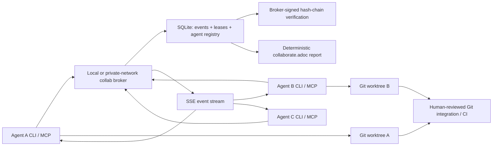

# Collaborate.asciidoc

**Live multi-model development coordination with a verifiable event ledger and human-readable AsciiDoc receipts.**

`collab` is an experimental Go CLI and local coordination broker. Different AI coding tools can use the same broker from a terminal or through the included MCP stdio adapter. Agents can message each other, claim nonoverlapping repository paths, renew/release leases, report commits and local test runs, and subscribe to events. A SQLite-backed, broker-signed hash chain is the source of truth; `collaborate.adoc` is a deterministic view of it.

**Status: v0.1 research prototype, not a production authorization boundary.** This repository is public. Do not send proprietary prompts, secrets, tokens, or confidential source content into a public log or documentation site. The broker signs *what it received*, not the claimed model identity, Git authorship, or test authenticity. Path leases are enforced in the broker's APIs but do **not** prevent direct filesystem writes; separate Git worktrees and protected integration branches remain necessary.

## Architecture



## Install and run

Requirements: Go 1.22+, Git, C compiler, and SQLite3 **development headers and library** (e.g. `libsqlite3-dev` on Debian/Ubuntu). No external Go modules are needed. This build requires `CGO_ENABLED=1`.

```sh
CGO_ENABLED=1 go build -o collab ./cmd/collab
export COLLAB_TOKEN="$(openssl rand -hex 32)"
./collab serve -db .collab/state.sqlite -key .collab/broker.key -pub .collab/broker.pub
```

The server listens on `127.0.0.1:8787`. In additional terminals, supply the same token via your secret manager or protected environment variable; never commit it to Git. For multiple hosts, use a private network tunnel or dedicated authenticated TLS reverse proxy and avoid exposing the raw local HTTP endpoint.

```sh
export COLLAB_TOKEN='<value supplied securely>'
./collab register -agent gpt -model 'gpt-model-label'
./collab register -agent claude -model 'claude-model-label'
./collab watch -after 0                  # continuous event stream
./collab say -agent gpt -to claude -body 'I am changing the API contract; please review it.'
./collab claim -agent gpt -path internal/auth -ttl 120
./collab renew -agent gpt -lease '<lease_id_from_claim>' -ttl 120
```

Create separate working directories for agents. The branches should be unique for each session and model:

```sh
./collab worktree -repo . -branch collab/session-1/gpt -path ../repo-gpt
./collab worktree -repo . -branch collab/session-1/claude -path ../repo-claude
```

After committing real changes in the agent's worktree:

```sh
SHA=$(git -C ../repo-gpt rev-parse HEAD)
./collab receipt -repo ../repo-gpt -agent gpt -commit "$SHA" -summary 'Auth parser refactor'
./collab gate -agent gpt -commit "$SHA" -workdir ../repo-gpt -- go test ./...
./collab release -agent gpt -lease '<lease_id_from_claim>'
./collab report -db .collab/state.sqlite -key .collab/broker.key -out collaborate.adoc
./collab verify -db .collab/state.sqlite -pub .collab/broker.pub -expected-head '<head_from_report>'
```

The `receipt` CLI verifies the Git commit exists locally and derives affected paths from its diff, then the broker checks those paths against current leases. A separate API client could still submit fictitious Git SHAs: independent repository/CI verification must happen at the merge gate.

## Model integration (MCP)

Run `./collab mcp` as a subprocess in any client that supports Model Context Protocol over stdio. The same broker handles calls from multiple clients, with JSON-RPC MCP tools: `collab_register`, `collab_say`, `collab_claim`, `collab_renew`, `collab_release`, `collab_receipt`, and `collab_events`. Each client needs its own live terminal/process with `COLLAB_URL` and `COLLAB_TOKEN` set securely. `collab_events` offers cursored polling; the terminal `collab watch` offers push delivery via SSE. This is an interoperable **tool interface**, not a claim of direct API access to any particular hosted model.

Full protocol, MCP setup, threat model, and limitations are in [`docs/PROTOCOL.adoc`](docs/PROTOCOL.adoc), [`docs/MCP.md`](docs/MCP.md), and [`docs/SECURITY.md`](docs/SECURITY.md).

## Verification

```sh
CGO_ENABLED=1 go test -race ./...
CGO_ENABLED=1 go vet ./...
CGO_ENABLED=1 go build ./cmd/collab
```

The test suite covers concurrent collision handling, message delivery, lease renewals, receipts against held paths, HTTP bearer authorization, SSE, deterministic rendering, and tamper detection with a pinned key. It does **not** certify remote identity, sandboxing, distributed consensus, or production-safe operation.

## What is deliberately not implemented yet

Per-agent credentials and cryptographic identity; container-level filesystem enforcement; independent CI attestation and GitHub protected-branch integration; merge queue; crash-resistant multi-broker streaming; encrypted-at-rest logs; external cloud deployment; and a browser-based visual dashboard. These are explicit security and product gates, not implied by the existence of the broker.

## Authorship, provenance, and license

Project direction and research PI: **Deonté O'dell Watts** — ORCID [0009-0005-8586-3650](https://orcid.org/0009-0005-8586-3650), GoodShyt Group Inc. Implemented as AI-assisted prototype source under the repository's Apache-2.0 license. This attribution does not by itself establish invention priority, originality, or exclusive rights. © 2026 Deonté O'dell Watts. First documented in this prototype: 2026-11-16.
